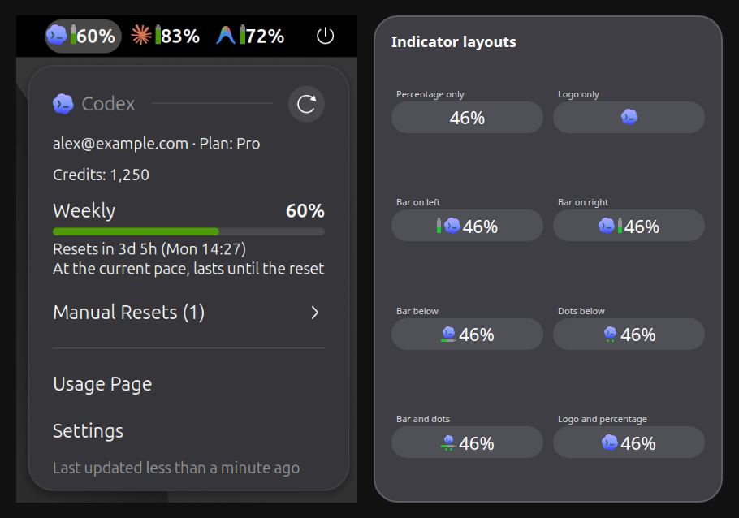

# Agent Usage Indicator

Shows how much of your Codex, Claude, Antigravity and other AI usage limits is
left, with one GNOME top-bar indicator per account. Open an indicator's menu to
see the account, plan, every usage window and the time until it resets.

Available in 20 languages (machine-translated; native-speaker review welcome).



## Install

Requires **GNOME Shell 50 or 51**. Install and enable
[Agent Usage Indicator on GNOME Extensions](https://extensions.gnome.org/extension/10644/codex-limit-indicator/).
It starts with one Codex account. Open **Settings** from an indicator's menu and
choose **Add Account…** for more.

## Accounts

Each account has its own indicator, menu, refresh interval and saved reading;
up to 16 accounts fit. You can add several accounts of every type except
Antigravity, whose CLI keeps a single login.

| Type | Sign in with | Get it from |
| --- | --- | --- |
| Codex | `codex login` with a ChatGPT account | [Codex CLI](https://learn.chatgpt.com/docs/codex/cli) |
| Claude | `claude auth login` with a Claude subscription | [Claude Code](https://code.claude.com/docs/en/setup) |
| Antigravity | `agy`, then complete sign-in; version 1.1.11 or newer | [Antigravity CLI](https://antigravity.google/docs/getting-started) |
| OpenRouter (beta) | An API key | [OpenRouter keys](https://openrouter.ai/keys) |
| DeepSeek (beta) | An API key | [DeepSeek API keys](https://platform.deepseek.com/api_keys) |
| Ollama Cloud (beta) | An API key | [Ollama keys](https://ollama.com/settings/keys) |
| Kimi Code (beta) | A Kimi Code API key, from China or international | [Kimi Code console](https://www.kimi.com/code/console) |
| Custom endpoint | A URL that returns JSON, and an optional key | Your own service |

**Beta, untested:** the OpenRouter, DeepSeek, Ollama Cloud and Kimi Code
accounts were built from each provider's API documentation without an account
to test them with. Kimi Code documents no usage API; the extension reads an
undocumented endpoint, as other usage monitors do, which may change. Please
[report problems](https://github.com/englertbruno/gnome_extension_agent_limit)
with the text of **Error Details** from the menu.

Codex supports ChatGPT logins only, and Claude supports Claude subscription
logins only; API-key, Bedrock and Vertex AI logins of these CLIs are unsupported.
An account's page in Settings links to the provider's install guide.

### Command-line logins

Codex, Claude and Antigravity accounts use the login of the provider's
command-line tool; sign in there before adding the account. For a second
Codex or Claude login, sign in with the CLI's `CODEX_HOME` or
`CLAUDE_CONFIG_DIR` set to another directory, and choose that directory as the
account's **Configuration directory**. An empty one uses the CLI's default
login.

### API keys

Paste the key into the account's **API Key** row. Settings stores it in the
default GNOME keyring as *Agent Usage Indicator: API key for* followed by the
provider's name; GNOME's Passwords and Keys app shows it there. Settings creates
the default keyring when there is none, and may ask you to unlock it. The indicator itself never asks: while the keyring
is locked, its menu says so and checks again every 30 seconds. Removing an
account deletes its key.

Kimi Code keys belong to a region: choose **China** (`api.kimi.com`) or
**International** (`api.kimi.ai`) to match where you created the key.

### Custom endpoint

A custom endpoint account reads one usage window from a JSON reply:

- **URL**: an `https` address, or `http` to this computer, such as
  `http://localhost:8080/usage`. The URL is saved as entered, query included,
  so a token in it is stored in settings; put keys in the **API Key** field
  instead, where they go to the keyring.
- **Key header** and **Text before the key**: how the optional key is sent,
  by default `Authorization: Bearer <key>`. The key is stored for the URL's
  host and is never sent to another host, so enter the URL first, and add the
  key again after changing the host. A key for an earlier host stays in the
  keyring until you remove the account; **Remove**, shown while a key for the
  current host is stored, deletes that key.
- **Response**: [JSON Pointers](https://www.rfc-editor.org/rfc/rfc6901) to
  the values, such as `/usage/percent`: either a percentage, used or
  remaining, or a used amount and a limit; and optionally a reset time, as an
  RFC 3339 time with an offset, such as `2026-11-20T09:00:00Z`, or as Unix
  seconds or milliseconds.
- **Window length** in minutes, for the window's name and run-out forecast,
  and an `https` **Usage page** for the **Usage Page** menu item.

For the reply `{"usage": {"percent": 42, "resets_at": "2026-11-20T09:00:00Z"}}`,
set the percentage to `/usage/percent`, counting **Used**, and the reset time to
`/usage/resets_at`.

## Use

Choose a usage window in an account's menu to show it in the top bar; until
you do, it shows the weekly window, or the longest one. The menu shows each
window's remaining share and reset time, a forecast at the current pace,
extra usage, credits and balances where the provider reports them, and
**Usage Page**, which opens the provider's own usage page.

Opening a menu updates its countdowns and reading age without fetching usage.
The **Refresh** button beside the account's name fetches it at once; the menu
stays open. Each account's page sets the interval of its automatic requests:

| Type | Default | Minimum |
| --- | --- | --- |
| Codex, Antigravity | 30 seconds | 30 seconds |
| Claude | 5 minutes | 5 minutes |
| API-key types, custom endpoint | 5 minutes | 1 minute |

A warning icon means the reading is stale. Open **Error Details** in the menu.

After a screen lock or a restart, each indicator shows its saved reading,
if it is less than a week old, until a new one arrives.

### Top bar

**Settings → Top Bar** chooses the logo, a battery bar, dots, the colors and
the label. **Position** places the indicators in the left, center or right
area of the top bar, at a position that counts the items of GNOME Shell and
other extensions there. Changing the area restarts the indicators.

The label is a template. Choose a preset or **Custom**, with these
placeholders:

| Placeholder | Shows |
| --- | --- |
| `{percent}` | The remaining percentage, or the used one with **Show Used Instead of Remaining**; an amount for a limit in money |
| `{remaining}`, `{used}` | The remaining or used percentage |
| `{reset}` | Time until the reset, such as `04h 29m` |
| `{reset_time}` | Clock time of the reset, such as `Thu 09:00` |
| `{window}` | The window's name, such as `Weekly` |
| `{account}` | The account's name |

For example, `{percent} · {reset}` shows `86% · 04h 29m`. A placeholder without
a value is left out with the separator beside it. Write `{{` and `}}` for
literal braces.

### Notifications

**Settings → Notifications** turns on each kind; all are off by default:

- **Low usage**: once per usage window, when the window shown in the top bar
  falls to the threshold, 10% by default.
- **Unused usage**: once per window of a day or longer, when the current pace
  would leave at least half of it, or the share you set, unused at the reset,
  no earlier than 24 hours before it.
- **Manual reset expiry**: once per Codex manual reset, when it expires
  within 48 hours.

Every manual reset that the extension redeems, by your choice or
automatically, ends with a notification of the result.

### Keyboard shortcut

**Settings → Menu and Behavior → Keyboard shortcut** sets a shortcut, with
<kbd>Ctrl</kbd>, <kbd>Alt</kbd> or <kbd>Super</kbd>, that opens the first
account's menu; <kbd>Left</kbd> and <kbd>Right</kbd> move to the other
accounts, and the shortcut closes the menu again. There is none by default.

### Usage history

While **Show Usage History** is on, as it is by default, each account records
how the remaining share of its windows changes (windows without a length, such
as Antigravity's, are not recorded), and the menu charts the use of
the shown window over the last seven days in three-hour bars. Turning it off
deletes the record.

### Codex manual resets

Codex can grant manual resets, which reset the usage limits at once and can
expire. The Codex menu lists them with their expiry under
**Manual Resets**. Choose one, or **Manual Reset…** for the next to
expire, and confirm to redeem it through `codex app-server`.

> [!WARNING]
> Redeeming a manual reset resets the account's current usage limits and
> cannot be undone. **Redeem Manual Resets Automatically Before They Expire**,
> on a Codex account's page, does this without asking: in the last hour before
> a reset expires, while the account has used part of a window. It is off by
> default; turn it on only if you would rather use a reset than lose it.

## Privacy

### Services contacted

The extension contacts only the services of the accounts you add. Its own
requests use HTTPS, except a custom endpoint on this computer, and never
follow redirects.

| Type | Contacted by the extension |
| --- | --- |
| Codex | Nothing; the installed `codex app-server` contacts OpenAI's services |
| Claude | `api.anthropic.com`, for the profile and usage; `claude doctor`, run to renew an expired login, contacts Anthropic's services |
| Antigravity | Nothing; the installed `agy --version` and `agy -p /usage` contact Google's services |
| OpenRouter | `openrouter.ai` |
| DeepSeek | `api.deepseek.com` |
| Ollama Cloud | `ollama.com` |
| Kimi Code | `api.kimi.com` or `api.kimi.ai`, by region |
| Custom endpoint | The host of the URL you enter |

These checks do not start an agent turn or spend model quota. **Open Usage
Page** opens the provider's page in your browser.

### Credentials

Codex and Antigravity read their own logins; the extension does not read
their credential files. For Claude, the extension reads the access token in
Claude Code's `.credentials.json`, in `~/.claude`, `$CLAUDE_CONFIG_DIR` or the
account's configuration directory, and sends it only to `api.anthropic.com`.
When that login has expired, the extension runs `claude doctor` once per
unchanged login, which renews it; if renewal fails, open Claude Code.

API keys stay in the GNOME keyring. The extension never writes credential
files, and never saves tokens or keys outside the keyring, except in a custom
endpoint URL, which is saved as entered; **Error Details** and the journal
hide tokens and keys.

### Files written

The extension keeps two private files per account, named after its slot,
such as `account-0`:

| File | Contents |
| --- | --- |
| `~/.cache/gnome-extension-codex-limit-indicator@bruno.englert.gitlab.com/account-0.json` | The last reading: the plan name, the remaining share and reset time of each window, credits, balances and manual resets; the time of the last request, a retry delay the service asked for and which notifications were shown |
| `~/.local/state/gnome-extension-codex-limit-indicator@bruno.englert.gitlab.com/account-0-history.json` | The remaining share of each window over the last eight days, while **Show Usage History** is on |

They never contain an email address, a name, a token or an API key; SHA-256
digests tell whether a file belongs to the account's current settings and
login. With `XDG_CACHE_HOME` or `XDG_STATE_HOME` set, the folders are there
instead. Removing an account deletes its files. Uninstalling the extension keeps them,
with the settings and any API keys in the keyring; remove the accounts first,
or delete the folders while the extension is disabled:

```sh
rm -r ~/.cache/gnome-extension-codex-limit-indicator@bruno.englert.gitlab.com \
    ~/.local/state/gnome-extension-codex-limit-indicator@bruno.englert.gitlab.com
```

The extension adds no telemetry.

## Credits and license

The indicator layout and color modes are based on
[Bluetooth Battery Meter](https://github.com/maniacx/Bluetooth-Battery-Meter),
whose implementation credits
[battery-indicator-icon](https://github.com/Deminder/battery-indicator-icon).

The Antigravity logo comes from Google's [official press assets](https://antigravity.google/press),
the OpenRouter logo from OpenRouter's [brand assets](https://openrouter.ai/brand) and the Ollama
logo from the [Ollama repository](https://github.com/ollama/ollama). DeepSeek, Kimi Code and custom
endpoints show a generic icon; DeepSeek's and Kimi's terms do not allow this use of their logos.

Codex, ChatGPT, Claude, Claude Code, Antigravity, Google, OpenRouter, DeepSeek,
Ollama and Kimi are trademarks of their respective owners. This extension is
not affiliated with or endorsed by them; their names and logos only identify
each service.

Licensed under [GPL-3.0-or-later](LICENSE). The indicator drawing code adapted
from Bluetooth Battery Meter is GPL-3.0-or-later; the other source files are
GPL-2.0-or-later.

## Support

- [Patreon](https://www.patreon.com/BrunoEnglert)
- [Buy Me a Coffee](https://www.buymeacoffee.com/brunoenglert)
